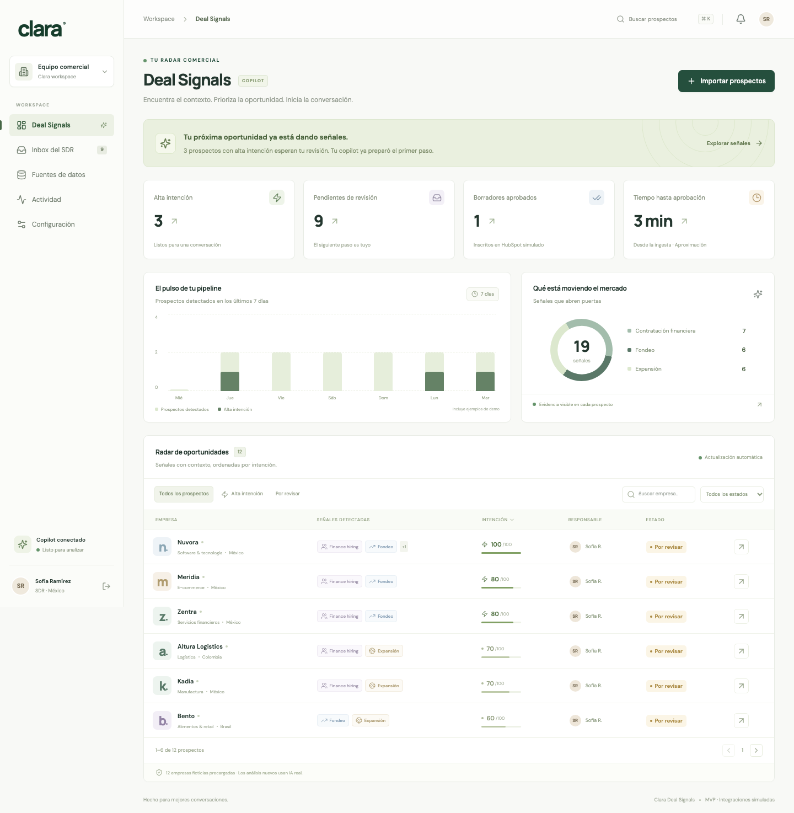
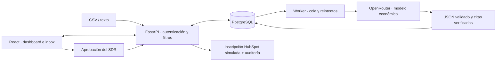

# Clara · Deal Signals & SDR Copilot

Una herramienta interna para convertir datos desordenados en oportunidades comerciales: importa una lista o una señal, obtiene contexto y un correo con IA real, y permite que el SDR edite, apruebe o rechace el siguiente paso.

**Demo:** https://clara-deal-signals.onrender.com · Acceso protegido por la contraseña `DEMO_PASSWORD` configurada en el servicio. No publiques esa contraseña en este repositorio.

> Proyecto de entrevista independiente, sin afiliación oficial con Clara. Las empresas precargadas son ficticias. Slack y HubSpot se simulan explícitamente: no se envían correos ni mensajes reales.



## Qué funciona

- Dashboard con búsqueda, filtros, score, métricas, gráficos y detalle con evidencia.
- CSV con separadores coma, punto y coma o tabulación, UTF-8/Latin-1, detección de columnas y confirmación del mapeo. Reporte de duplicados y filas descartadas.
- Texto pegado de vacantes, noticias o correos. Normalización de dominios, bloqueo de correos personales y deduplicación antes del LLM.
- Análisis real con OpenRouter: señales respaldadas por citas, resumen, ángulo de venta y borrador en español.
- Inbox interactivo que representa Slack: alta intención a DM, resto a `#leads-intel`.
- Edición con control de versiones; aprobación idempotente que guarda una inscripción en HubSpot **simulado** y una copia exacta del mensaje aprobado.
- Cola persistente, recuperación después de reinicios, máximo tres intentos automáticos, backoff y tareas fallidas con reintento manual.
- Reglas y plantilla editables; auditoría con actor, fecha y acción; trazas de prompts y respuestas en PostgreSQL.
- Login con cookie firmada, HttpOnly, SameSite y Secure en el servidor publicado. Claves exclusivamente en backend.

## Ejecutar localmente

Requisitos: Node.js 22 y Python 3.12. En Windows usa WSL para el script o sigue los comandos manuales.

```bash
git clone git@github.com:Jesus105/clara_app.git
cd clara_app
cp .env.example .env
# Configura OPENROUTER_API_KEY, DEMO_PASSWORD y SESSION_SECRET en .env.
bash scripts/dev.sh
```

Abre **http://localhost:8000**. El mismo servidor entrega frontend y API. El script construye el frontend y aplica las migraciones. Para una ejecución local rápida se usa SQLite; el despliegue y Docker utilizan PostgreSQL.

Sin API key puedes explorar los ejemplos precargados. Los nuevos análisis fallarán con un mensaje visible; nunca se sustituyen por respuestas falsas. Si conservaste los nombres `OPENROUTERKEY` y `RENDER` en tu `.env`, los scripts también los reconocen.

### Desarrollo con recarga

```bash
python3 -m venv .venv
.venv/bin/pip install -r backend/requirements.lock
cd backend
../.venv/bin/alembic upgrade head
../.venv/bin/uvicorn app.main:app --reload
# En otra terminal, desde la raíz:
npm --prefix frontend ci
npm --prefix frontend run dev
```

Vite abre en http://localhost:5173 y redirige `/api` al backend. Login de desarrollo, si no configuraste otro: `clara-demo-local`. No uses ese valor en un servidor público.

### Docker con PostgreSQL y worker separado

```bash
docker compose up --build
```

La app vive en http://localhost:8000. PostgreSQL persiste en un volumen. La API no procesa tareas en este modo: el contenedor `worker` usa la misma cola. Para Render gratuito el worker corre dentro del proceso de la API, evitando contratar un servicio adicional.

## Recorrido para el video de tres minutos

1. **0:00–0:35:** Dashboard → abre Nuvora. Muestra score, señales y cita original. Explica que el score lo calcula código a partir de evidencia extraída por IA.
2. **0:35–1:20:** Fuentes → descarga/importa `leads-evento.csv` → confirma columnas. Muestra las tres filas válidas, un duplicado, un Gmail descartado y un dato incompleto. El procesamiento corre en segundo plano.
3. **1:20–2:05:** Inbox → canal `leads-intel` y DM de Copilot. Revisa el correo de un prospecto, edita el asunto, guarda y aprueba. La inscripción es simulada; el humano decide.
4. **2:05–2:45:** Actividad → muestra aprobación, edición, tokens y latencia de análisis reales. Cola → errores y reintentos. Configuración → pesos, umbral y plantilla.
5. **2:45–3:00:** Explica la integración pendiente con Slack/HubSpot reales y el beneficio esperado. No presentes 10 segundos o un ahorro de 25 minutos como resultados medidos de esta demo.

## Arquitectura y contrato de API



El score suma una sola vez cada tipo: contratación financiera **40**, fondeo **30**, expansión **20**, dominio corporativo **10**; máximo **100**. Desde **80** se representa una alerta DM. Las reglas nuevas aplican a análisis posteriores; no alteran los históricos.

Contratos y ejemplos: [API](docs/API.md). Decisiones, modelo de datos, seguridad y límites: [Arquitectura](docs/ARCHITECTURE.md). Despliegue, diagnóstico y respaldo: [Operación](docs/OPERATIONS.md).

## Presupuesto de IA

Modelo por defecto: `google/gemini-2.5-flash-lite`, seleccionado desde el catálogo de OpenRouter. El precio se consulta antes de cada generación; no se presupone permanente.

La aplicación permite **US$3 de consumo total de la key**, contando también usos previos. Antes de solicitar un análisis:

1. Reserva **US$0.02** en una fila de PostgreSQL bloqueada transaccionalmente.
2. Consulta el consumo total de la key; si la reserva excede el límite, detiene la solicitud.
3. Verifica que el modelo pertenezca a una lista económica y que el costo máximo de entrada/salida sea menor que la reserva. Limita entrada y salida; no usa herramientas ni búsqueda de pago.
4. Si OpenRouter reporta costo exacto, ajusta la reserva; si falta o hay un fallo, conserva la reserva por precaución.

Este control limita las llamadas realizadas por la app. Otros clientes que compartan la key pueden consumir créditos fuera de ella. Para un tope global adicional configura un límite de US$3 para esta key en OpenRouter y úsala exclusivamente para la demo. El runtime nunca recibe la credencial de Render.

## Pruebas

```bash
.venv/bin/pytest backend/tests -q
npm --prefix frontend run build
cd frontend
npx playwright install chromium
npm run test:e2e
```

Las pruebas de backend cubren autorización, CSRF, importación, deduplicación, score, evidencia, versiones, idempotencia, cola, recuperación, errores del LLM y presupuesto. Las pruebas de navegador usan una base temporal y un backend sin acceso a IA real: recorren dashboard, edición/aprobación, CSV, Slack y navegación móvil.

GitHub Actions ejecuta backend, migración y compilación frontend en cada push y PR. La prueba real de generación se hace aparte para evitar consumir la key desde CI.

## Despliegue y límites de la demo

Todo corre en **Render Free**, sin un worker de pago ni disco adicional. `render.yaml` reproduce los recursos; [scripts/deploy.py](scripts/deploy.py) crea/reutiliza exclusivamente servicios con plan `free` y guarda solo identificadores en `.local/deployment.json`.

```bash
.venv/bin/python scripts/deploy.py provision-db
.venv/bin/python scripts/deploy.py deploy
.venv/bin/python scripts/deploy.py status
# Después de subir cambios a GitHub:
.venv/bin/python scripts/deploy.py redeploy
```

La app gratuita duerme tras 15 minutos sin tráfico y puede tardar aproximadamente un minuto en despertar. PostgreSQL gratuito vence a los 30 días; hay que exportar los datos antes del vencimiento. No hay SLA ni backup automático. El alojamiento gratuito es adecuado para la entrevista; no se considera infraestructura de producción permanente. [Documentación oficial de Render](https://render.com/docs/free).

Vercel es opcional: `frontend/vercel.json` incluye proxy del API. Si cambia el dominio de Render, actualiza ese destino y `ALLOWED_ORIGINS`. El despliegue entregado usa un solo origen en Render.

## Siguiente versión

Conectar Slack Block Kit e interacciones firmadas, OAuth de HubSpot con revisión humana, enriquecimiento autorizado, secretos administrados, warehouse y observabilidad externa. Antes de tráfico real: usuarios/roles individuales, backups, límites por usuario, worker independiente, monitoreo y dimensionamiento. Esas integraciones no se presentan como ya conectadas en esta demo.

